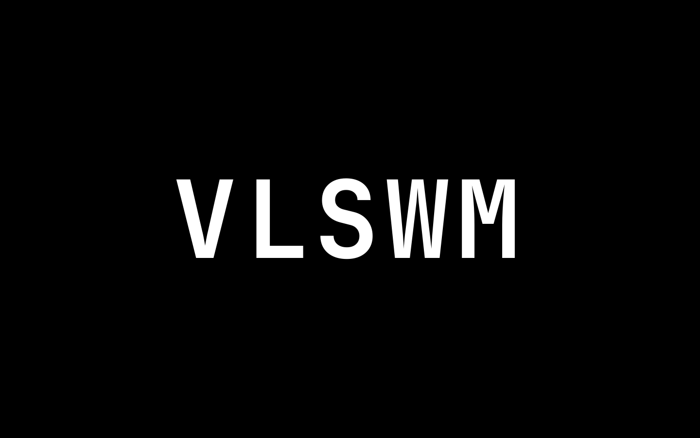
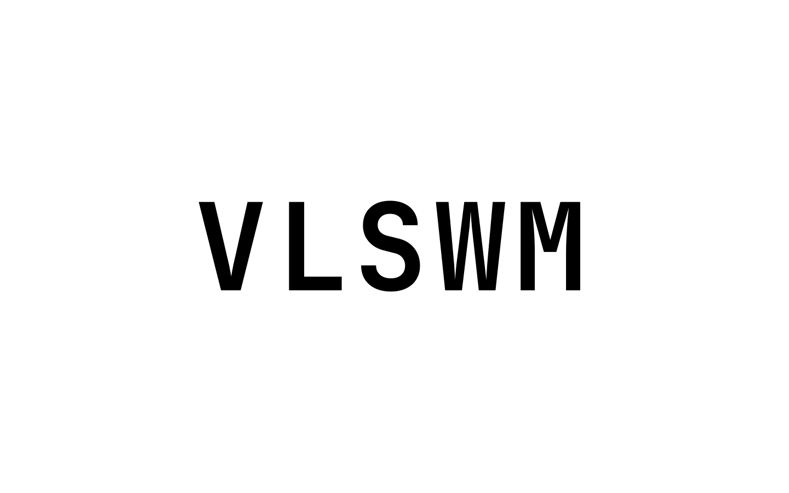
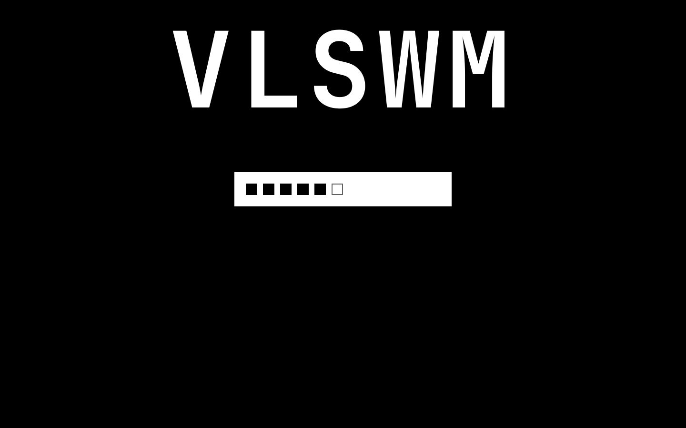
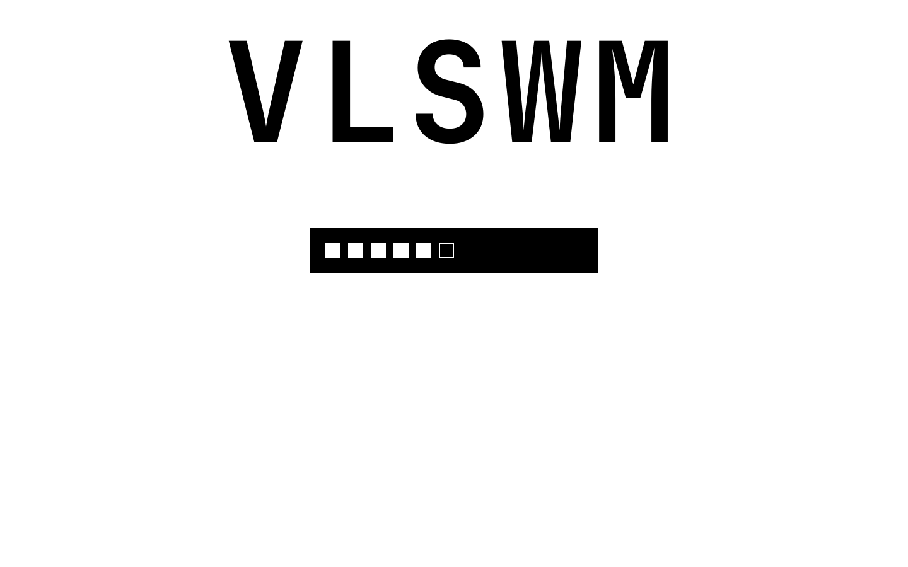

# VLSWM — SDDM theme

[Русский](README.ru.md)

Minimal black-and-white SDDM theme for [VLSWM](https://github.com/Vlad175cm/VLSWM).
Only `#000000` and `#ffffff`, only square corners, no wallpaper, no icons, no user name.

Idle: a large `VLSWM` in the middle of the screen. The first key moves the
wordmark to the top and reveals a white input plate. Every character of the
password is a black square; the newest square fades in on its own. A wrong
password inverts the whole screen for 80 ms and shows `ACCESS DENIED`.

| Dark | Light |
| --- | --- |
| [](assets/preview-dark.png) | [](assets/preview-light.png) |
| [](assets/preview-typing-dark.png) | [](assets/preview-typing-light.png) |

## Requirements

- SDDM 0.21 or newer (both the Qt5 and Qt6 greeter work).
- `JetBrainsMono Nerd Font` with Bold. The theme does not bundle fonts.

## Install

```sh
git clone https://github.com/Vlad175cm/vlswm-sddm-theme.git
cd vlswm-sddm-theme
sudo ./install.sh
```

The script:

- verifies that SDDM and the theme source files exist;
- creates `/usr/share/sddm/themes` and `/etc/sddm.conf.d` if they are missing;
- copies the theme to `/usr/share/sddm/themes/vlswm`;
- creates `/etc/sddm.conf.d/theme.conf` if it is missing;
- otherwise backs it up to `theme.conf.bak.YYYY-MM-DD-HHMMSS`, keeps every other section and changes only `Current=` inside `[Theme]`;
- does not create another backup when `Current=vlswm` is already active;
- warns if `/etc/sddm.conf` also sets `[Theme] Current=...`, because it can override `conf.d`.

The theme is used by the next SDDM login screen.

Try it without touching the system:

```sh
sddm-greeter --test-mode --theme "$PWD"
# or, on Qt6 systems:
sddm-greeter-qt6 --test-mode --theme "$PWD"
```

## Controls

| Action | Key |
| --- | --- |
| Reveal the input field (first key counts) | any key, or click |
| Log in | `Enter` |
| Clear the password | `Esc` |
| Hide the field when it is already empty | `Esc` again |
| Toggle black / white while the field is hidden | `T` |
| Toggle black / white at any time | `Ctrl+T` |
| Power off / reboot / suspend (no visible buttons) | `Ctrl+Shift+P` / `Ctrl+Shift+R` / `Ctrl+Shift+S` |

`T` at idle is a theme shortcut, so a password that starts with `t` needs a
click on the screen first (or type any other character first). Once the field
is visible, `t` is a normal password character; use `Ctrl+T` to switch theme.

## Configuration

`/usr/share/sddm/themes/vlswm/theme.conf`:

```ini
[General]
# dark | light
palette=dark
# Text in the middle of the screen
title=VLSWM
# true: type a demo password automatically after 1 s (screenshots only)
demo=false
```

Changes apply the next time the greeter starts.

## How it stays black and white

The wordmark uses `Text.NativeRendering`: it disables the subpixel colour
fringes that normally appear on large white-on-black text. The failure flash
is not a shader; the theme simply swaps the background and foreground roles
for 80 ms, which inverts every element at once.

## Uninstall

```sh
sudo ./uninstall.sh
```

The script removes `/usr/share/sddm/themes/vlswm` and restores the newest
`/etc/sddm.conf.d/theme.conf.bak.*` if one exists.

## License

MIT. See [LICENSE](LICENSE).
