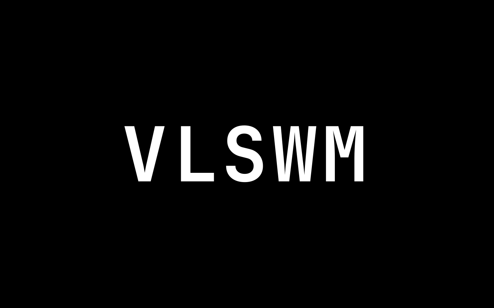
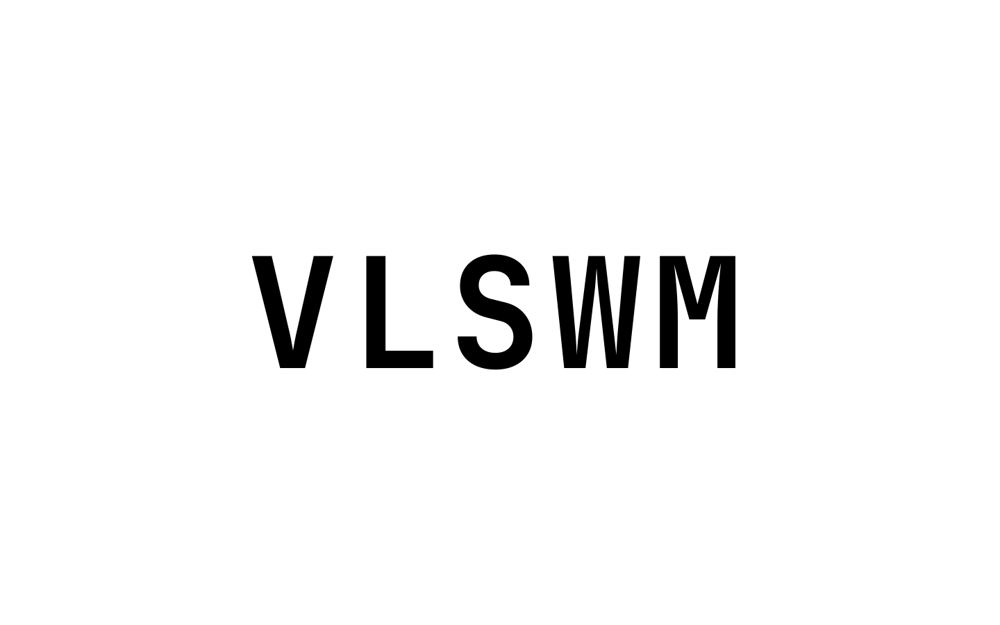
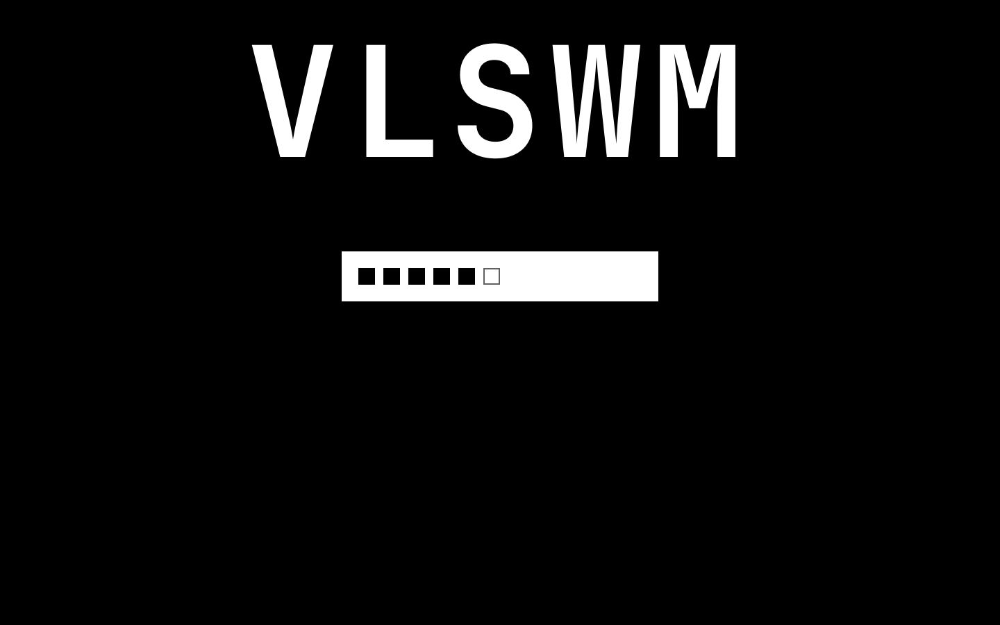
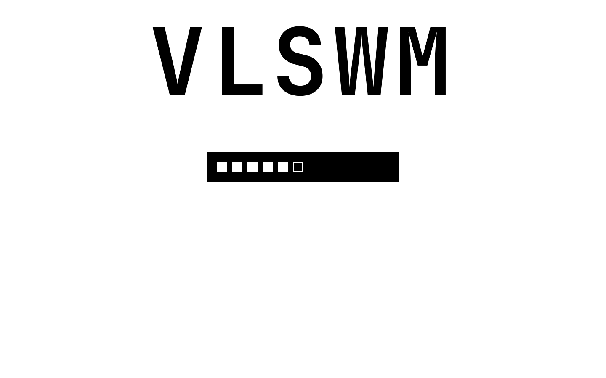

# VLSWM — тема SDDM

[English](README.md)

Минимальная чёрно-белая тема SDDM для [VLSWM](https://github.com/Vlad175cm/VLSWM).
Только `#000000` и `#ffffff`, только прямые углы, без обоев, иконок и имени пользователя.

В покое — крупная надпись `VLSWM` по центру. Первая клавиша поднимает её к
верхней кромке и открывает белую плашку ввода. Каждый символ пароля — чёрный
квадрат; новый квадрат появляется отдельным мягким Fade. Неверный пароль
инвертирует весь экран на 80 мс и показывает `ACCESS DENIED`.

| Чёрная | Белая |
| --- | --- |
| [](assets/preview-dark.png) | [](assets/preview-light.png) |
| [](assets/preview-typing-dark.png) | [](assets/preview-typing-light.png) |

## Зависимости

- SDDM 0.21 или новее (работают и Qt5-, и Qt6-greeter).
- Шрифт `JetBrainsMono Nerd Font`, начертание Bold. Шрифт в тему не встраивается.

## Установка

```sh
git clone https://github.com/Vlad175cm/vlswm-sddm-theme.git
cd vlswm-sddm-theme
sudo ./install.sh
```

Скрипт:

- копирует тему в `/usr/share/sddm/themes/vlswm`;
- сохраняет бэкап `/etc/sddm.conf.d/theme.conf` в `theme.conf.bak.ГГГГ-ММ-ДД-ЧЧММСС`;
- не трогает остальные секции файла и ставит `Current=vlswm`.

Тема появится на следующем экране входа SDDM.

Проверить без установки:

```sh
sddm-greeter --test-mode --theme "$PWD"
# или, на Qt6:
sddm-greeter-qt6 --test-mode --theme "$PWD"
```

## Управление

| Действие | Клавиша |
| --- | --- |
| Показать поле ввода (первая клавиша засчитывается) | любая клавиша или клик |
| Войти | `Enter` |
| Очистить пароль | `Esc` |
| Убрать поле, если оно уже пустое | `Esc` ещё раз |
| Переключить чёрную / белую тему, пока поле скрыто | `T` |
| Переключить тему в любой момент | `Ctrl+T` |
| Выключить / перезагрузить / усыпить (без кнопок на экране) | `Ctrl+Shift+P` / `Ctrl+Shift+R` / `Ctrl+Shift+S` |

`T` в покое — это горячая клавиша темы, поэтому пароль, начинающийся с `t`,
нужно начинать после клика по экрану (или ввести любой другой символ первым).
Когда поле видно, `t` — обычный символ пароля, а тема переключается по `Ctrl+T`.

## Настройка

`/usr/share/sddm/themes/vlswm/theme.conf`:

```ini
[General]
# dark | light
palette=dark
# Текст по центру экрана
title=VLSWM
# true: автоматически ввести демо-пароль через 1 с (только для скриншотов)
demo=false
```

Изменения применяются при следующем запуске greeter.

## Почему нет цветных каёмок

Для надписи включён `Text.NativeRendering`: он убирает субпиксельные цветные
каёмки, которые обычно появляются на крупном белом тексте по чёрному фону.
Инверсия при ошибке — не шейдер: тема на 80 мс меняет роли фона и текста
местами, поэтому инвертируется вся сцена сразу.

## Удаление

```sh
sudo ./uninstall.sh
```

Скрипт удаляет `/usr/share/sddm/themes/vlswm` и восстанавливает самый свежий
`/etc/sddm.conf.d/theme.conf.bak.*`, если он есть.

## Лицензия

MIT. См. [LICENSE](LICENSE).
